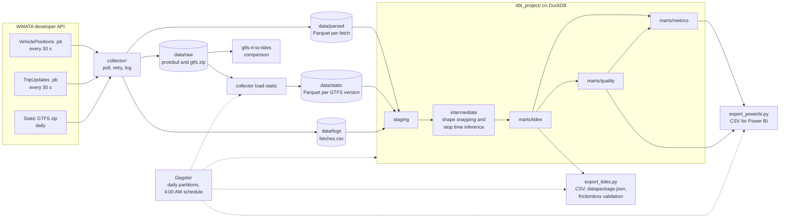

# WMATA bus GTFS-Realtime to TIDES

**Question:** how trustworthy is public real-time bus data as a source for on-time
performance?

This pipeline collects WMATA's public bus GTFS-Realtime feeds, converts them to
[TIDES](https://github.com/TIDES-transit/TIDES) tables, validates the output against the
TIDES v1.0 schemas, runs data quality checks, and measures how much on-time performance
moves when bad data is filtered out. It also runs prior work,
[gtfs-rt-to-tides](https://github.com/evansiroky/gtfs-rt-to-tides), on the same raw files
and compares the results.

Stack: Python 3.12, DuckDB, Parquet, dbt-duckdb, Dagster, frictionless, pytest, ruff, GitHub
Actions.
The dashboard is built by hand from the extracts, in Power BI (`docs/DASHBOARD_SPEC.md`)
or Tableau, which runs on macOS (`docs/TABLEAU_SPEC.md`).

## What it does

1. **Collect.** `collector/` polls WMATA's VehiclePositions and TripUpdates feeds every 30
   seconds and downloads the static GTFS once per day. It saves the raw protobuf, a Parquet
   copy of each fetch, and one log line per fetch. Errors are retried with backoff and never
   stop the loop.
2. **Stage.** dbt dedupes repeated pings, converts times to America/New_York, and joins each
   ping to the static GTFS version in effect on its service date.
3. **Infer stop times.** Pings and stops are snapped to each trip's route shape in plain SQL.
   Arrival and departure times at every stop are interpolated between pings, with handling
   for layovers, loops, and GPS jitter (`docs/METHODOLOGY.md`).
4. **TIDES.** Three TIDES tables: vehicle_locations, trips_performed, and stop_visits.
   `scripts/export_tides.py` writes them as CSV with a `datapackage.json` and validates both
   against the official schemas.
5. **Data quality.** dbt tests plus custom checks for service area, impossible speeds, stale
   pings, off-route pings, coverage gaps, missed polls, incomplete trips, and unobserved
   trips. A `data_quality` mart summarizes every check by day and route.
6. **Metrics.** On-time performance by route, stop, and hour, using WMATA's published
   definition by default; headway adherence; bunching; and the same OTP at loose, moderate,
   and strict quality levels.
7. **Dashboard extracts.** `scripts/export_powerbi.py` writes CSVs for Power BI or Tableau.
8. **Orchestration.** Dagster runs steps 2 to 7 once per service day, with a coverage check,
   the dbt tests, and TIDES validation as asset checks.

## Architecture



## Key findings

All numbers come from one window: 2026-11-06, 11:00 AM to 2:00 PM Eastern, 250,685 distinct
pings from 999 vehicles. Three midday hours on one weekday is a small sample, so these
describe that window, not WMATA bus service in general. Details and the rest of the
numbers are in `docs/DATA_QUALITY.md`.

- **The feed was reliable.** 694 fetches across both feeds: none failed, came back empty, or
  repeated a stale header. Vehicle positions were a median of 3 s old when fetched.
- **WMATA appears to snap positions to the route.** The median ping on a trip is 0.28 m from
  its shape. Clean positions in the public feed do not prove clean GPS on the bus, and raw
  GPS error cannot be measured from it.
- **Trip IDs change at the wrong moments for stop inference.** WMATA attaches a trip_id
  after the bus leaves the first stop and moves the bus to its next trip before it reaches
  the last stop. It never reported a bus `STOPPED_AT` the last stop of its trip (0 of 12,975
  pings that targeted one). The pipeline handles this with the vehicle's pings before and
  after each trip and a first-stop fallback.
- **Data quality moves systemwide OTP a little and route OTP a lot.** OTP was 76.06% with no
  quality filter, 76.36% with the moderate filter, and 77.66% with the strict filter. For the
  22 routes with enough data, strict minus loose ranged from -6.03 to +22.17 points. The
  strict filter keeps only 17.2% of timepoint events.
- **Bunching and headways.** 3.09% of consecutive bus pairs left a timepoint under 2 minutes
  apart. On frequent service, 72.1% of headways met WMATA's headway rule.
- **Unobserved trips.** No vehicle was seen operating 58 of 1,488 trips (3.9%) scheduled
  entirely inside the window. That is an upper bound on missed trips.
- **Prior work does not run on WMATA data as published.** gtfs-rt-to-tides wrote 0 vehicle
  location rows (a leftover debug exit) and stopped reading at 11:59:59 AM (gtfs_kit compares
  GTFS times as text, and WMATA writes hours like `9:59:59`). After a minimal patch it found
  the same 250,685 pings, but its output does not validate against TIDES v1.0.

## How to run

### Setup

```bash
~/.local/bin/python3.12 -m venv .venv
```

```bash
.venv/bin/pip install -e ".[dev]" -c requirements-lock.txt
```

```bash
cp .env.example .env
```

Then paste your key from developer.wmata.com after `WMATA_API_KEY=` in `.env`. `.env` is
gitignored and the key is sent only in the `api_key` header, never in a URL or log.

### Collect

```bash
scripts/start.sh
```

```bash
.venv/bin/python -m collector status
```

```bash
.venv/bin/python -m collector rows-per-minute --date 2026-11-06
```

```bash
scripts/stop.sh
```

The background run uses `nohup` and `caffeinate`. It survives closing the terminal but stops
while the Mac sleeps (for example when the lid closes), and it does not restart after a
crash or reboot. `.venv/bin/python -m collector run` runs it in the foreground.

### Build

On everything collected so far:

```bash
.venv/bin/python -m collector load-static
```

```bash
cd dbt_project && ../.venv/bin/dbt build --profiles-dir .
```

On the fixed window used for the numbers in the docs:

```bash
scripts/build_snapshot.sh
```

### Orchestrate with Dagster

The collector keeps running on its own. Dagster runs the daily batch for each service day,
one partition per day from 3:00 AM to 3:00 AM Eastern, so trips past midnight stay with
their day:

| Asset | What it does |
|---|---|
| `collection_coverage` | Share of the day's 30-second polls that succeeded. Check warns under 95% |
| `static_gtfs/*` | Runs `collector load-static`, one asset per GTFS table |
| dbt models | `dbt build` for that day's window into `data/daily/<date>/warehouse.duckdb`. Every dbt test shows up as an asset check |
| `tides_package` | TIDES CSVs and `datapackage.json` in `data/tides/<date>/`. Blocking check: valid against TIDES v1.0 |
| `dashboard_extracts` | Power BI / Tableau CSVs in `data/powerbi/<date>/`. Skipped if the TIDES check fails |

Start the UI at http://localhost:3000:

```bash
scripts/dagster.sh
```

In the UI, open Jobs, `daily_pipeline`, pick a date partition, and materialize it, or
launch a backfill for several dates. The schedule `daily_pipeline_schedule` runs each day's
partition at 4:00 AM once it is turned on in the UI. To run one day from the terminal:

```bash
DAGSTER_HOME="$PWD/orchestration/dagster_home" .venv/bin/dagster job execute -m orchestration.definitions -j daily_pipeline --tags '{"dagster/partition": "2026-11-06"}'
```

Each day builds into its own DuckDB file, so the snapshot used by the docs
(`data/warehouse.duckdb`, from `scripts/build_snapshot.sh`) is never overwritten.

### Export and report

```bash
.venv/bin/python scripts/export_tides.py --date 2026-11-06
```

```bash
.venv/bin/python scripts/export_powerbi.py
```

```bash
.venv/bin/python scripts/report.py
```

`report.py` prints every number cited in `docs/`. The comparison with gtfs-rt-to-tides is
`scripts/compare_gtfs_rt_to_tides.py`; `docs/DATA_QUALITY.md` section 5 explains its setup.

### Test

```bash
.venv/bin/pytest -q
```

```bash
cd dbt_project && ../.venv/bin/dbt build --profiles-dir . --vars '{data_dir: ../data/sample}'
```

CI (`.github/workflows/ci.yml`) runs ruff, pytest, `dbt build` on the committed sample in
`data/sample/` (one hour of real data for routes C53, D60, and A58, built by
`scripts/make_sample.py`), TIDES validation, and dbt docs.

### dbt docs

The generated docs site is committed at `docs/dbt-docs/index.html` (built from the sample).
Open it in a browser. To regenerate:

```bash
cd dbt_project && ../.venv/bin/dbt docs generate --profiles-dir . --vars '{data_dir: ../data/sample}' --static
```

## Repository layout

```
collector/              feed collector, status and reparse commands, static GTFS loader
dbt_project/
  models/staging/       cleaned feeds and typed static GTFS
  models/intermediate/  shape segments, snapping, stop time inference, scheduled trips
  models/marts/tides/   TIDES vehicle_locations, trips_performed, stop_visits
  models/marts/quality/ checks, data_quality summary, OTP sensitivity
  models/marts/metrics/ OTP, headways, bunching, dimensions
  macros/, tests/       SQL helpers and macro tests
spec/tides-v1.0/        official TIDES v1.0 schemas (CC-BY-4.0)
orchestration/          Dagster assets, checks, daily job and schedule
scripts/                start/stop, Dagster UI, exports, report, comparison, sample builder
tests/                  pytest
docs/                   METHODOLOGY, DATA_QUALITY, DASHBOARD_SPEC, TABLEAU_SPEC, dbt docs
data/                   gitignored, except data/sample/
```

## Disk use

First run, 2026-11-06, 10:19 AM to 1:44 PM: 321 polling cycles with 0 failed fetches. The
cycles used 207.0 MB of raw protobuf and 77.4 MB of Parquet, an average of 886 KB per cycle.
At 2,880 cycles per day that is 2.55 GB per day, plus 35 MB for the daily static GTFS zip.
This is a daytime rate. Overnight service runs fewer buses, so a full day should use less.
The full-day number is [X] GB until a complete day is collected.

## Limitations

- **A public real-time feed is a stand-in for an agency's internal AVL data, which is what
  TIDES is designed for.** AVL records positions at a fixed rate with door and odometer
  events. The public feed is sampled every 30 s, appears to be snapped to the route, and has
  no door events, passenger counts, or operator data. Every stop time here is an estimate.
- There is no ground truth. Stop times have a consistency check against the feed's own
  STOPPED_AT status, not a check against AVL door events.
- The documented numbers cover three midday hours on one day, collected on a laptop. The
  window includes a 7-minute gap while the laptop slept (12:03 to 12:10 PM).
- Missed trips are only bounded. A trip with no vehicle may be missed or may have a bus that
  reported no trip_id.
- The bunching threshold (2 minutes) is this project's choice. WMATA publishes an on-time
  window and a headway rule, but not a bunching definition.
- The service area check is a bounding box around all stops, not WMATA's actual boundary.

## Credits

- [TIDES](https://github.com/TIDES-transit/TIDES), Transit ITS Data Exchange Specification,
  by the TIDES Board of Directors. Schemas in `spec/tides-v1.0/` are unchanged copies under
  CC-BY-4.0.
- [gtfs-rt-to-tides](https://github.com/evansiroky/gtfs-rt-to-tides) by Evan Siroky (MIT), the
  prior work this project compares against. Its raw folder layout is reused so its parsers
  run on this project's files.
- WMATA for the bus GTFS and GTFS-Realtime feeds, through the WMATA developer API.
- [Dagster](https://dagster.io) and dagster-dbt for orchestration.
- [gtfs-realtime-bindings](https://github.com/MobilityData/gtfs-realtime-bindings),
  [DuckDB](https://duckdb.org), [dbt-duckdb](https://github.com/duckdb/dbt-duckdb),
  [frictionless](https://framework.frictionlessdata.io), and
  [gtfs_kit](https://codeberg.org/araichev/gtfs_kit) (used by the comparison).
